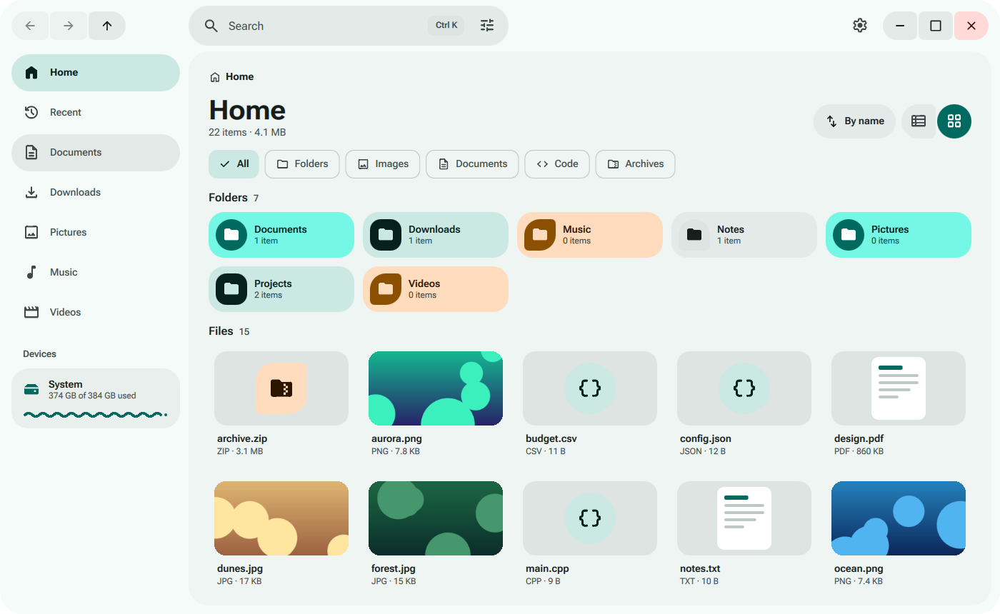
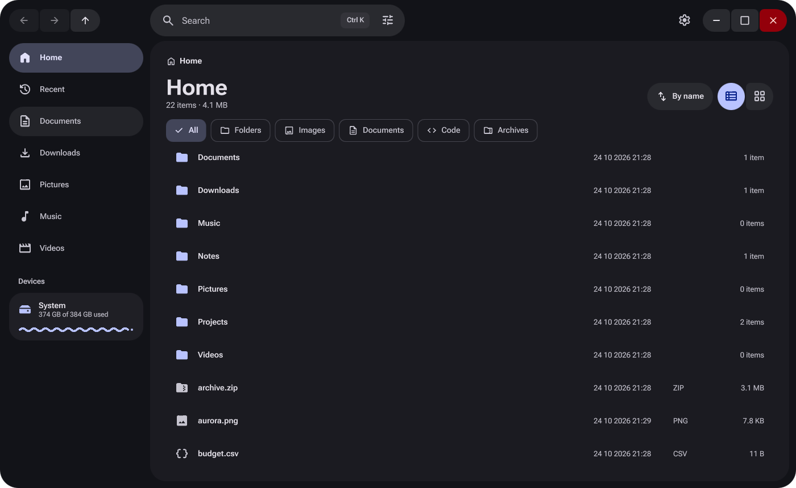
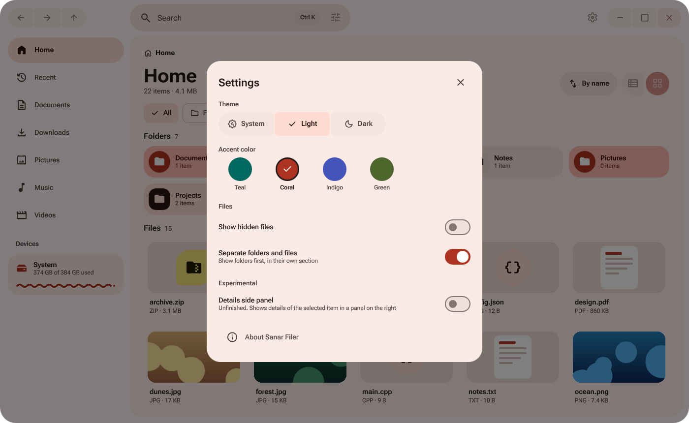

# Sanar Filer

> [!NOTE]
> **Repository Mirrors**
>
> - **git.nuros.org** ([sanarde/filer](https://git.nuros.org/sanarde/filer)): primary, self-hosted Forgejo instance, accounts restricted to the core team.
> - **GitHub** ([sanarde/filer](https://github.com/sanarde/filer)): mirror for external contributors. Issues and Pull Requests opened here are welcome and are reviewed and processed by the core team.







## About

Sanar Filer is a file manager for SanarDE.

The application id is `org.nuros.sanar.filer`.

## Dependencies

- Qt 6.8 or newer (Core, Gui, Quick, DBus)
- Sanar Style
- CMake 3.21 or newer
- A C++20 compiler
- gettext tools (xgettext, msgmerge, msgfmt)

Optional at run time:

- UDisks2, for mounting and ejecting devices
- Thumbnailers in `/usr/share/thumbnailers`, for video and PDF thumbnails

## Build

```
cmake -S . -B build -G Ninja
cmake --build build
./build/src/sanar-filer
```

If Sanar Style is installed outside the system prefix, pass its prefix with `-DCMAKE_PREFIX_PATH=<prefix>` when configuring and set `QML_IMPORT_PATH=<prefix>/lib/qt6/qml` when running.

To install, run `cmake --install build --prefix <prefix>`. This installs the executable, the icons, the desktop file and the AppStream metadata.

## Translations

Message catalogs are in `po`. After changing strings in QML, run `cmake --build build --target update-po`. To run from the build tree, configure with `-DSANAR_FILER_LOCALEDIR=$PWD/build/locale`.

## Palettes

Colors, palettes and fonts come from Sanar Style. See its documentation for the palette format and the location of custom palettes.

## Thumbnails

Thumbnails are cached in `$XDG_CACHE_HOME/thumbnails` following the freedesktop thumbnail specification. Images are decoded directly. Video and PDF thumbnails are produced by the thumbnailers installed on the system (`/usr/share/thumbnailers/*.thumbnailer`, for example `totem-video-thumbnailer` or `papers-thumbnailer`). Without a matching thumbnailer a generic icon is shown.

## Devices

Removable volumes are listed in the sidebar. Mounting, unmounting and powering off use the UDisks2 service on the system bus. Without the service only mounted volumes are shown and the eject button is not available.

## Recent files

The Recent location lists existing files from `$XDG_DATA_HOME/recently-used.xbel`, newest first. The file is read only. Sanar Filer does not add entries to it.

## Clipboard

Copy and cut place the selected files on the system clipboard as `text/uri-list` and `x-special/gnome-copied-files`, so files can be pasted between applications.

## Links

- [ROADMAP.md](ROADMAP.md)
- [CONTRIBUTING.md](CONTRIBUTING.md)

## License

GNU General Public License v3.0. See [LICENSE](LICENSE).
